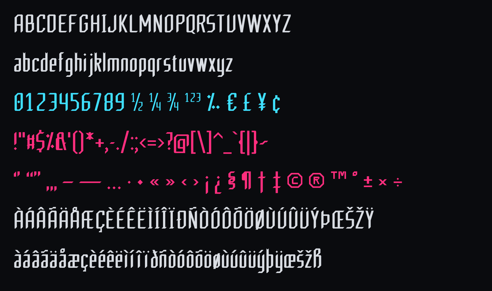

# Vulpes Ferrea 鐵狐體



**Vulpes Ferrea** ("Iron Fox") is a display typeface that rebuilds the skeleton of Textura blackletter with chamfered cyberpunk geometry: straight lines only, 45° cuts, and a fixed module grid. From a distance a line of text reads as an iron fence; up close every stroke end is a blade.

*鐵狐體：發想於賽博龐克的切角幾何，組合上哥德織體的骨架。採用重視直線、切角代替曲線、固定格線的方式開發。遠看有鐵柵般的冷硬印象，近看有各種尖銳如刀口般的切角。*

| | |
| --- | --- |
| Style | Regular (one weight) |
| Version | 0.300 |
| Character set | Basic Latin, Latin-1 Supplement, Windows-1252 — 224 code points, 271 glyphs |
| OpenType | `kern` `pnum` `tnum` `zero` `case` `frac` `numr` `dnom` |
| Formats | OTF, TTF (autohinted), WOFF2, UFO |
| License | [SIL Open Font License 1.1](OFL.txt) |
| Best for | Titles, logos, interface headings, game UI — 20 px and above |

## Download and use

- **Desktop** (Photoshop, Illustrator, Word, Figma): install [`fonts/otf/VulpesFerrea-Regular.otf`](fonts/otf/). Install either the OTF or the TTF, not both.
- **Web and apps**: use [`fonts/webfonts/VulpesFerrea-Regular.woff2`](fonts/webfonts/).

```css
@font-face {
  font-family: "Vulpes Ferrea";
  src: url("VulpesFerrea-Regular.woff2") format("woff2");
  font-display: swap;
}
h1   { font-family: "Vulpes Ferrea", sans-serif; }
.num { font-feature-settings: "pnum"; }   /* figures are tabular by default */
.caps { text-transform: uppercase; font-feature-settings: "case"; }
```

Try it before installing: open [`documentation/webtest.html`](documentation/webtest.html) in a browser (type your own text, change the size, toggle OpenType features), or see the full specimen in [`documentation/specimen.html`](documentation/specimen.html).

## Design

Four rules, applied to every glyph:

1. **Picket fence** — in lowercase, stem, counter and the space between letters are all 90 units: the dense vertical rhythm of Textura.
2. **Broken strokes** — no curves; every turn is a 45° chamfer.
3. **Pen axis** — large chamfers only at top-left and bottom-right, small ones at top-right and bottom-left, as if every letter were cut by the same blade.
4. **Forged parts** — stems 90, bars 60, diagonals ≈ 64. A small set of standard parts, like structural steel.

Three signature marks: the **fox ear** notch on ascenders (`h d l b k`), the **blade cut** on free stroke ends, and the **diamond** (period, i-dot, the centre of zero).

Full specification, concept and character-set architecture (in Traditional Chinese) are in [`documentation/design/`](documentation/design/).

## How the font is made

The outlines are not drawn by hand. [`scripts/build_glyphs.py`](scripts/build_glyphs.py) is the design source: it computes every glyph from the module grid and the parts defined in the spec, so stems, angles and grid positions are guaranteed by code. No outline was traced or copied from another font.

```
scripts/build_glyphs.py ──► sources/glyphs.json ──► scripts/export_fonts.py ──► fonts/ + sources/*.ufo + documentation/
        ▲                                                                              │
        └──────────────────────────── review the specimen ◄────────────────────────────┘
```

## Building

Requires Python 3.11+.

```bash
pip install -r requirements.txt
python scripts/build_glyphs.py     # or: make build
```

- `build_glyphs.py` regenerates the outlines and then builds everything. It exits with an error if any glyph breaks the spec; the report is written to [`documentation/check.md`](documentation/check.md).
- `python scripts/export_fonts.py` (or `make fonts`) rebuilds the fonts from `sources/glyphs.json` without touching the outlines.
- Only `shapely` and `fonttools` are required. Missing optional packages skip their output (hinting, WOFF2, UFO, preview image, OTS check) and say so in the report.
- Builds are reproducible: with the versions pinned in `requirements.txt`, the same source produces byte-identical font files.
- To hand-edit a glyph, open `sources/VulpesFerrea-Regular.ufo` in FontForge, FontLab or Fontra. Note that the next `build_glyphs.py` run regenerates the UFO, so permanent changes belong in the generator.

GitHub Actions builds the fonts on every push and attaches them to each published release.

## Repository layout

```
├─ fonts/            otf/  ttf/  webfonts/   ready-to-use font files
├─ sources/          glyphs.json (generated outlines), VulpesFerrea-Regular.ufo
├─ scripts/          build_glyphs.py (design source), export_fonts.py, specimen.py
├─ documentation/    specimen, web test page, check report, design/ (spec and concept)
├─ OFL.txt           license
├─ FONTLOG.txt       version history
├─ AUTHORS.txt       copyright holders
└─ CONTRIBUTORS.txt  everyone who contributed
```

## Authors

Designed by **FOX**. The specification, glyph generator and engineering were produced with Claude Opus 5.5 (Anthropic) under FOX's direction. See [AUTHORS.txt](AUTHORS.txt) and [CONTRIBUTORS.txt](CONTRIBUTORS.txt).

## License

This Font Software is licensed under the SIL Open Font License, Version 1.1. This license is copied in [OFL.txt](OFL.txt) and is also available with a FAQ at <https://openfontlicense.org>.

In short: you may use, embed, modify and redistribute the fonts, including in commercial work. You may not sell the fonts by themselves, and modified versions must be released under the OFL as well.

---

## 中文說明

**鐵狐體**是一套標題用的英數字型：以哥德織體的垂直節奏為骨架，用 45° 切角取代所有曲線。字集涵蓋 ASCII、Latin-1 與 Windows-1252（含歐文重音字母與常用排版符號），目前沒有中文字。

- **下載使用**：桌面軟體安裝 `fonts/otf/` 的 OTF；網頁或 App 用 `fonts/webfonts/` 的 WOFF2。OTF 和 TTF 擇一即可。
- **線上試看**：用瀏覽器打開 `documentation/webtest.html`，可以輸入文字、調字級、開關 OpenType 功能。
- **pip  建置**：`pip install -r requirements.txt` 後執行 `python scripts/build_glyphs.py`。
- **授權**：SIL Open Font License 1.1。可免費用於個人與商業用途、可內嵌、可修改再散布；不能單獨販售字型檔，改版也必須用 OFL 釋出。
- **設計文件**：`documentation/design/`（造形規範、設計主軸、文字架構、出處與授權）。
